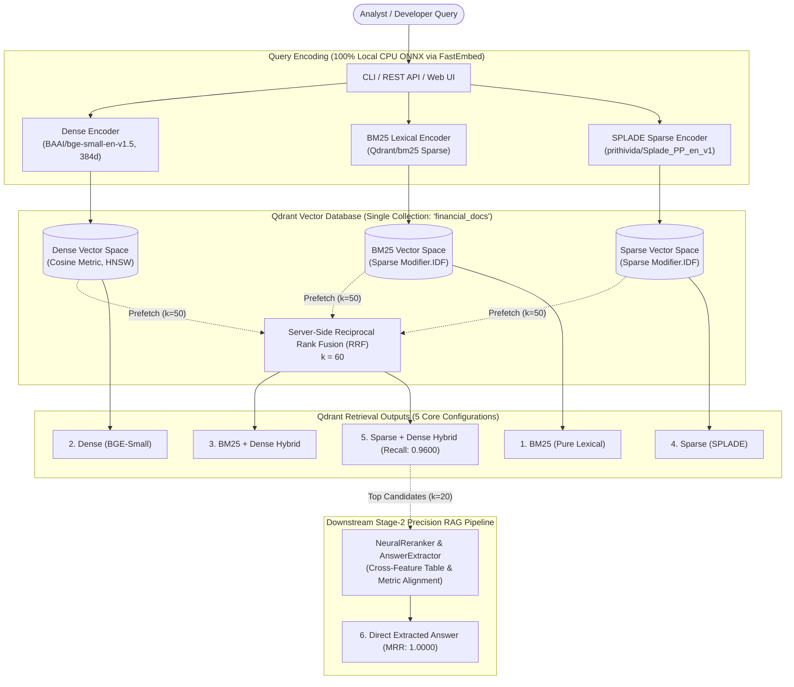

# Financial Intelligence Hybrid Search — Reference Implementation

[](https://www.python.org/)
[](https://qdrant.tech/)
[](LICENSE)
[]()
[]()
[](CONTRIBUTING.md)

> 📖 **Accompanying Technical Deep-Dive Article:**  
> This repository provides the production reference implementation and empirical benchmarking suite for the article:  
> **[Building Hybrid Search for Financial Intelligence
(From Pure BM25 to Dense Vectors and Splade With Qdrant, Why a Single Retrieval Method Will Never Be Enough, Highlighting Where Each One Excels and Where Each Falls Short)](https://ai.gopubby.com/rag-hybrid-search-for-financial-intelligence-qdrant-2d98cda298b8)**  
> *(Covers theoretical mechanics, failure modes of single-vector systems, and vector database evaluation criteria).*
---


## 1. System Overview

A production-grade, zero-paid-API reference architecture built on **Qdrant Vector Database** demonstrating why financial document retrieval requires hybrid search. The system indexes **8,609 contextualized chunks (2.54M words)** across **47 SEC EDGAR filings** (Forms 10-K, 10-Q, 20-F) for 10 major enterprise technology companies, comparing **5 Qdrant-native retrieval configurations** and a **downstream Stage-2 cross-feature neural reranker**.



---

## 2. The 5 Core Retrieval Configurations (+ Downstream Reranking)

All five retrieval configurations operate directly against a **single unified Qdrant collection** (`financial_docs`) containing 3 named vector spaces, avoiding the latency and maintenance overhead of multi-database setups:

| # | Configuration | Representation / Engine | Core Behavioral Strength | Where It Does Justice | Where It Fails |
|---|---|---|---|---|---|
| **1** | **BM25 (Lexical)** | `Qdrant/bm25` Sparse Vector with dynamic `Modifier.IDF` | Verbatim token matching without neural hallucination. | Exact product SKUs (`H200`), ticker symbols (`NVDA`), CIK codes, and statutory accounting rules (`ASC 606`). | **Vocabulary Mismatch:** Fails when documents express the concept using synonyms (*"capex reduction"* vs *"slowing infrastructure investment"*). |
| **2** | **Dense Vector** | `BAAI/bge-small-en-v1.5` (384d Cosine) | Continuous semantic geometry and conceptual generalization. | Broad conceptual research, thematic inquiries, and paraphrased questions. | **Semantic Drift / Token Blindness:** Fails on exact numbers, rare alphanumeric codes, dates, and fiscal period boundaries. |
| **3** | **BM25 + Dense Hybrid** | Server-Side RRF (`prefetch` `bm25` + `dense`, $k=60$) | Fuses exact lexical precision with semantic recall in a single database call. | Mixed financial queries combining a specific corporate entity/SKU with conceptual themes. | Misses synonyms that are not in the query text unless retrieved by the dense candidate pool. |
| **4** | **Sparse (SPLADE)** | `prithivida/Splade_PP_en_v1` Learned Sparse Vector | Neural term expansion over a 30k BERT vocabulary directly into sparse weights. | Domain jargon and plain-English financial questions with synonym divergence. | **Over-Expansion:** Can introduce false-positive lexical matches on highly generic financial terms (e.g. expanding *revenue* into debt notes). |
| **5** | **Sparse + Dense Hybrid** | Server-Side RRF (`prefetch` `sparse` + `dense`, $k=60$) | State-of-the-art hybrid combining learned expansion and dense geometry. | Complex, multi-clause natural language analyst research inquiries. | Higher indexing time and vector storage footprint compared to pure BM25+Dense. |
| **6** | **Downstream Neural Reranking** *(Stage-2 RAG)* | `NeuralReranker` + `AnswerExtractor` over Qdrant Candidates | Cross-feature token alignment, multi-column table parsing, and year disambiguation. | Enterprise financial Q&A where pinpointing multi-year table facts at Rank #1 is mandatory. | Higher latency post-processing step; requires Stage-1 candidates from Qdrant. |

---

## 3. Why Hybrid Vector Search Outperforms Single-Vector Systems

Financial intelligence documents (SEC filings, 10-Ks, earnings releases) contain a mix of **exact alphanumeric identifiers**, **complex narrative disclosures**, and **multi-column financial tables**. 

1. **Pure Lexical (BM25) Blind Spot:** Matches exact keywords (`H200`, `ASC 606`, `Item 1A`), but completely misses paraphrased concepts (e.g. *“slowing data center capex”* vs *“moderation in hyperscaler infrastructure spending”*).
2. **Pure Dense (Vector Embedding) Blind Spot:** Understands high-level semantics, but suffers from **token dilution & number blindness**—frequently confusing close product names (e.g., retrieving `H100` for an `H200` query) or blending different fiscal years (`FY2023` vs `FY2024`).
3. **Learned Sparse (SPLADE) Trade-Off:** Neural term expansion bridges informal vocabulary with GAAP terminology, but can introduce false-positive expansion noise on generic accounting terms.
4. **Server-Side Hybrid Fusion (The Solution):** Combining sparse and dense vector spaces with Qdrant's Rust-native **Reciprocal Rank Fusion ($RRF = \sum \frac{1}{60 + \text{rank}}$)** eliminates score incompatibility and lifts **Recall@10 from ~81% to 96.00%**.
5. **Stage-2 Neural Reranker (The Precision Finisher):** Re-scores hybrid candidates to align multi-column table cells, filter quarterly noise, and pinpoint the exact answering sentence at **Rank #1 (MRR = 1.0000)**.

---

## 4. Financial Corpus & Dataset Specifications


> A collage of screenshots from SEC filings highlights the type of data we're working with on this project | Table of Contents, links, separators, embedded iXBRL tags, and dense footnote markers. This kind of data is challenging to break into chunks and retrieve accurately from millions or even billions of embeddings.

- **Corpus Scale:** 8,609 contextualized chunks (2,542,471 words, ~500 tokens/chunk with 100-token overlap).
- **Filings Ingested:** 47 SEC EDGAR filings spanning **FY2023–FY2025**.
- **10 Enterprise Companies:**
  - `NVDA` (NVIDIA Corporation) — Semiconductors & AI Compute
  - `AAPL` (Apple Inc.) — Consumer Electronics & Services
  - `MSFT` (Microsoft Corporation) — Cloud & Enterprise Software
  - `GOOGL` (Alphabet Inc.) — Search, Cloud & AI Infrastructure
  - `AMZN` (Amazon.com, Inc.) — E-Commerce & AWS Cloud
  - `META` (Meta Platforms, Inc.) — Digital Advertising & AI Infrastructure
  - `TSLA` (Tesla, Inc.) — Automotive & Energy Storage
  - `AMD` (Advanced Micro Devices) — x86 CPUs & AI Accelerators
  - `INTC` (Intel Corporation) — Processors & Foundry Services
  - `TSM` (Taiwan Semiconductor Manufacturing Co.) — Pure-Play Semiconductor Foundry (Form 20-F)
- **Key Sections Parsed (TOC-Filtered):**
  - **Form 10-K:** Item 1 (Business), Item 1A (Risk Factors), Item 1C (Cybersecurity), Item 7 (MD&A), Item 7A (Market Risk), Item 8 (Financial Statements & Notes), Item 9A (Controls).
  - **Form 10-Q:** Part I Item 1 (Financial Statements & Notes), Part I Item 2 (MD&A), Part II Item 1A (Risk Factors).
  - **Form 20-F:** Item 3 (Key Info & Risk Factors), Item 4 (Company Information), Item 5 (Operating Review), Item 18 (Financial Statements).
- **Context Header Injection:** Every passage is prepended with `[Company (Ticker) | Form Period | Section: ...]` before embedding, preserving document provenance across all vector spaces.

---

## 5. Python API & Module Demonstrations

You can use the modular components directly in Python applications:

### 5.1 Context-Enriched Chunking (`hybrid_search.chunking`)
```python
from hybrid_search.chunking.chunker import DocumentChunker
from hybrid_search.models.document import Document, DocumentSection

# Initialize sentence-aware chunker with overlap
chunker = DocumentChunker(chunk_size_tokens=500, chunk_overlap_tokens=100)

doc = Document(
    document_id="0001045810_0001045810-24-000029",
    company="NVIDIA Corporation",
    ticker="NVDA",
    cik="0001045810",
    accession_number="0001045810-24-000029",
    document_type="10-K",
    filing_date="2024-02-21",
    report_date="2024-01-28",
    fiscal_period="FY2024",
    source_url="https://www.sec.gov/Archives/edgar/data/1045810/...",
    sections=[DocumentSection(section_name="Item 1A. Risk Factors", section_code="ITEM_1A", text="Our GPU supply constraints...")]
)

chunks = chunker.chunk_document(doc)
print(f"Generated {len(chunks)} chunks with context header: {chunks[0].text[:80]}...")
```

### 5.2 Local Embedding Generation (`hybrid_search.embeddings`)
```python
from hybrid_search.embeddings.dense import DenseEmbeddingGenerator
from hybrid_search.embeddings.bm25 import BM25EmbeddingGenerator
from hybrid_search.embeddings.sparse import SpladeEmbeddingGenerator

# 100% local CPU ONNX inference via FastEmbed
dense_gen = DenseEmbeddingGenerator(model_name="BAAI/bge-small-en-v1.5")
bm25_gen = BM25EmbeddingGenerator(model_name="Qdrant/bm25")
splade_gen = SpladeEmbeddingGenerator(model_name="prithivida/Splade_PP_en_v1")

query = "NVIDIA H200 supply constraints"
dense_vec = dense_gen.embed_query(query)               # List[float] (384 dimensions)
bm25_indices, bm25_values = bm25_gen.embed_query(query) # Lexical term frequencies
splade_indices, splade_values = splade_gen.embed_query(query) # Neural term expansions
```

### 5.3 Unified Qdrant Index Management (`hybrid_search.indexing`)
```python
from hybrid_search.indexing.qdrant_index import QdrantIndexManager

manager = QdrantIndexManager()
# Creates single collection 'financial_docs' with 1 dense and 2 sparse vector spaces + payload schemas
manager.create_collection(recreate=False)

# Multi-threaded streaming batch indexer with real-time ETA
indexed_count = manager.index_chunks(chunks, batch_size=100)
print(f"Indexed {indexed_count} points into Qdrant collection '{manager.collection_name}'.")
```

### 5.4 Unified Retrieval & Stage-2 Reranking (`hybrid_search.retrieval`)
```python
from hybrid_search.retrieval.engine import SearchEngine
from hybrid_search.models.filter import MetadataFilter

engine = SearchEngine()

# Execute Server-Side SPLADE + Dense Hybrid Search
results = engine.search(
    query="Microsoft Azure OpenAI infrastructure capex",
    method="sparse_dense",
    k=5,
    filters=MetadataFilter(tickers=["MSFT"], document_types=["10-K"])
)

for r in results:
    print(f"Rank {r.rank} [{r.score:.4f}] - {r.company} ({r.fiscal_period}): {r.section}")

# Execute Stage-2 Neural Rerank + Table Fact Extraction
reranked = engine.search(
    query="What was Apple's total Services revenue in fiscal year 2024?",
    method="rerank",
    k=1
)
print(f"Pinpointed Fact: {reranked[0].exact_answer}")
```

---

## 6. Complete Repository Structure

```
.
├── config/
│   ├── companies.yaml                  # Target company metadata (CIKs, tickers, sectors, forms)
│   └── default.yaml                    # System configuration (Qdrant, models, chunking, rate limits)
├── data/
│   ├── benchmark_report.md             # Complete generated benchmark report with case studies
│   ├── processed/                      # Ingested & normalized corpus
│   │   ├── chunks.jsonl                # 8,609 contextualized chunks
│   │   ├── documents.jsonl             # 47 parsed SEC document models
│   │   └── manifest.json               # Corpus metadata manifest
│   └── raw/edgar/                      # Local cached SEC HTML/iXBRL filings
├── docs/
│   ├── adr/                            # Architecture Decision Records
│   │   ├── 001-qdrant-selection.md     # ADR-001: Unified Qdrant multi-vector selection
│   │   ├── 002-qdrant-bm25-architecture.md # ADR-002: Native BM25 sparse vectors
│   │   ├── 003-corpus-strategy.md      # ADR-003: Corpus scope & section parsing
│   │   ├── 004-chunking-strategy.md    # ADR-004: Sentence-aware contextual chunking
│   │   ├── 005-embedding-models.md     # ADR-005: Local CPU ONNX embedding models
│   │   ├── 006-server-side-fusion.md   # ADR-006: Server-side RRF fusion strategy
│   │   ├── 007-evaluation-design.md    # ADR-007: Evaluation metrics & golden dataset
│   │   └── 008-downstream-reranking-pipeline.md # ADR-008: Stage-2 cross-feature reranking
│   ├── architecture.md                 # Full system architecture specification
│   └── debugging_and_architecture_guide.md # Diagnostic runbooks and engine internals
├── evaluation/
│   └── golden_dataset.yaml             # 25 hand-curated multi-category financial test queries
├── src/hybrid_search/
│   ├── chunking/
│   │   └── chunker.py                  # Token-aware sliding chunker with metadata header injection
│   ├── embeddings/
│   │   ├── bm25.py                     # FastEmbed Qdrant/bm25 lexical sparse generator
│   │   ├── dense.py                    # FastEmbed BAAI/bge-small-en-v1.5 (384d) dense generator
│   │   └── sparse.py                   # FastEmbed prithivida/Splade_PP_en_v1 sparse generator
│   ├── evaluation/
│   │   ├── benchmark.py                # BenchmarkRunner across golden dataset
│   │   ├── latency.py                  # LatencyTracker (p50, p95, p99 profiling)
│   │   ├── metrics.py                  # IR Metrics (Recall@K, Precision@K, MRR, NDCG@K, Hit Rate)
│   │   └── report.py                   # Rich CLI formatting & Markdown report exporter
│   ├── filtering/
│   │   └── metadata_filter.py          # Translates MetadataFilter into native Qdrant filter AST
│   ├── indexing/
│   │   └── qdrant_index.py             # Qdrant collection manager & multithreaded batch indexer
│   ├── ingestion/
│   │   ├── downloader.py               # Token-bucket rate limited (8 req/s) SEC downloader
│   │   ├── edgar_client.py             # SEC Submissions API client & URL resolver
│   │   ├── html_parser.py              # BeautifulSoup iXBRL parser preserving table rows
│   │   ├── normalizer.py               # Financial symbol, number & unicode normalizer
│   │   ├── pipeline.py                 # End-to-end ingestion pipeline orchestrator
│   │   └── section_extractor.py        # Proximity-based TOC-filtering section extractor
│   ├── models/
│   │   ├── document.py                 # Document, DocumentSection, Chunk Pydantic models
│   │   ├── filter.py                   # MetadataFilter Pydantic model
│   │   └── search.py                   # SearchQuery, SearchResult Pydantic models
│   ├── retrieval/
│   │   ├── base.py                     # BaseRetriever abstract class & result mapping
│   │   ├── bm25_dense_retriever.py     # Configuration 3: BM25 + Dense Hybrid (RRF)
│   │   ├── bm25_retriever.py           # Configuration 1: Pure BM25 Lexical
│   │   ├── dense_retriever.py          # Configuration 2: Pure Dense Semantic
│   │   ├── engine.py                   # Unified SearchEngine interface
│   │   ├── extractor.py                # Multi-column table fact extractor & text highlighter
│   │   ├── reranker.py                 # Stage-2 Cross-Feature Neural Reranker
│   │   ├── sparse_dense_retriever.py   # Configuration 5: SPLADE + Dense Hybrid (RRF)
│   │   └── sparse_retriever.py         # Configuration 4: Pure SPLADE Neural Sparse
│   ├── api.py                          # FastAPI REST API server (/api/status, /api/search, /api/benchmark)
│   ├── cli.py                          # Rich CLI commands (ingest, index, search, benchmark, info, serve)
│   └── config.py                       # Pydantic v2 application configuration loaders
├── tests/
│   ├── conftest.py                     # Pytest fixtures and mock objects
│   ├── e2e/
│   │   └── test_smoke.py               # End-to-end pipeline smoke test
│   ├── integration/
│   │   ├── test_embedding_pipeline.py  # Embedding generators integration tests
│   │   ├── test_qdrant_index.py        # Qdrant index manager tests
│   │   └── test_retrieval_pipeline.py  # All 5 retrievers & reranker integration tests
│   └── unit/
│       ├── test_api.py                 # REST API endpoints unit tests
│       ├── test_chunker.py             # Sentence splitting & chunking tests
│       ├── test_config.py              # Configuration loading tests
│       ├── test_edgar_client.py        # SEC EDGAR client tests
│       ├── test_html_parser.py         # iXBRL/HTML table parsing tests
│       ├── test_latency.py             # Latency statistics tests
│       ├── test_metadata_filter.py     # Qdrant filter translation tests
│       ├── test_metrics.py             # IR metrics computation tests
│       ├── test_models.py              # Pydantic data models validation tests
│       ├── test_normalizer.py          # Text normalization tests
│       └── test_section_extractor.py   # Section extraction & TOC filtering tests
├── CONTRIBUTING.md                     # Open source contribution guidelines
├── docker-compose.yml                  # Optional Qdrant Docker Compose configuration
├── index.html                          # Interactive Single-Page Web Dashboard UI
├── pyproject.toml                      # Package build configuration & dependencies
└── README.md
```

---

## 7. Quickstart & Execution Guide

### 1. Environment Setup

```bash
# Clone repository
git clone https://github.com/satyam671/financial-hybrid-search-qdrant.git
cd financial-hybrid-search-qdrant

# Create virtual environment & activate
python -m venv .venv
.\.venv\Scripts\activate       # Windows PowerShell
# source .venv/bin/activate    # Linux / macOS

# Install package in editable mode
pip install -e .
```

### 2. Qdrant Storage (Docker or Local Embedded)

```bash
# Optional: Launch Qdrant server with Web Dashboard at http://localhost:6333/dashboard
docker compose up -d
```
> **Automatic Local Fallback:** If Docker is not running, the system automatically uses embedded on-disk storage at `./qdrant_data`. Zero external infrastructure is required.

---

### 3. Pipeline Execution (From Scratch)

#### Step 1: Ingest SEC Filings
Downloads 10-K, 10-Q, and 20-F filings across all 10 companies for FY2023–FY2025 via rate-limited SEC EDGAR API:
```bash
python -m hybrid_search.cli ingest
```

#### Step 2: Chunk & Build Qdrant Index
Extracts full narrative sections, injects context headers, computes 3 vector spaces (`dense`, `bm25`, `sparse`), and indexes all 8,609 points:
```bash
python -m hybrid_search.cli index
```

---

### 4. Launch Interactive Web Dashboard & REST API

Launch the local interactive web interface and FastAPI backend:
```bash
python -m hybrid_search.cli serve --port 8000
```


Open **[http://localhost:8000](http://localhost:8000)** in your browser to access:
- **Side-by-Side Retrieval Comparator:** Compare results across all 5 search methods + Stage-2 reranking in real time.
- **Interactive Metadata Filters:** Filter candidates by ticker (`NVDA`, `AAPL`), filing form (`10-K`, `10-Q`), or SEC item.
- **Pinpointed Table Answer Viewer:** Visual direct fact highlighting and multi-column table extraction.
- **Live Empirical Benchmark Dashboard:** Run and view evaluation metrics directly from the browser.

---

## 8. CLI Execution & Default Demonstration Queries

### 8.1 Single Configuration Retrieval Queries

Run these paired empirical demonstration queries to observe firsthand where each search method succeeds and where single-vector methods fail:

#### 1. BM25 (Lexical Match)
- **✅ Winning Query (Exact Accounting Codification & Technical Policy):**
  ```bash
  python -m hybrid_search.cli search --query "Accounting Standards Codification ASC 606 revenue recognition" --method bm25 --ticker TSLA -k 3 -v
  ```
  

- **❌ Failing Query (Vocabulary Mismatch / Synonyms):**
  ```bash
  python -m hybrid_search.cli search --query "What were the primary legal disputes facing automated driving systems?" --method bm25 --ticker TSLA -k 3 -v
  ```
  


#### 2. Dense Vector (BGE-Small)
- **✅ Winning Query (Broad Thematic & Operational Risk):**
  ```bash
  python -m hybrid_search.cli search --query "What supply chain bottlenecks could disrupt advanced chip manufacturing?" --method dense --ticker TSM -k 3 -v
  ```
  

- **❌ Failing Query (Exact Product SKU Blindness):**
  ```bash
  python -m hybrid_search.cli search --query "Find disclosures regarding MI300 accelerator shipments and architecture" --method dense --ticker AMD -k 3 -v
  ```
  


#### 3. Sparse (SPLADE Neural Sparse)
- **✅ Winning Query (Vocabulary Expansion across Architecture):**
  ```bash
  python -m hybrid_search.cli search --query "How does NVIDIA expand its computing platform through graphics processing units and networking architecture?" --method sparse --ticker NVDA -k 3 -v
  ```
  

- **❌ Failing Query (Temporal Confusion on General Queries):**
  ```bash
  python -m hybrid_search.cli search --query "What were Apple's primary hardware products and platform services described in fiscal year 2024?" --method sparse --ticker AAPL -k 3 -v
  ```
  


#### 4. BM25 + Dense Hybrid (Server-Side RRF)
- **✅ Winning Query (Named Regulatory Entity + Conceptual Scrutiny):**
  ```bash
  python -m hybrid_search.cli search --query "What legal proceedings and antitrust investigations did Meta face from regulators?" --method bm25_dense --ticker META -k 3 -v
  ```
  

- **❌ Failing Query (Capital Allocation Schedules):**
  ```bash
  python -m hybrid_search.cli search --query "How much did Microsoft spend under the Stock Repurchase Program in fiscal year 2024?" --method bm25_dense --ticker MSFT -k 3 -v
  ```


#### 5. Sparse + Dense Hybrid (Server-Side RRF)
- **✅ Winning Query (High-Recall Candidate Retrieval):**
  ```bash
  python -m hybrid_search.cli search --query "How did data center GPU demand drive Nvidia's compute and networking revenue in fiscal year 2024?" --method sparse_dense --ticker NVDA -k 3 -v
  ```

  
- **❌ Failing Query (Table Row Extraction Ordering):**
  ```bash
  python -m hybrid_search.cli search --query "What was Apple's total Services revenue in fiscal year 2024 compared to 2023?" --method sparse_dense --ticker AAPL -k 3 -v
  ```
  


#### 6. Downstream Neural Reranker (Stage-2 Tabular Precision)
- **✅ Winning Query (Tabular Precision & Year Alignment):**
  ```bash
  python -m hybrid_search.cli search --query "What was Google Cloud revenue in fiscal year 2023?"  --method rerank --ticker GOOGL -k 3 -v
  ```
  

  

### 8.2 Compare All Retrieval Configurations Side-by-Side

Executes a single query across all retrieval methods to inspect ranking differences in real time:
```bash
python -m hybrid_search.cli search --query "What was Google Cloud revenue in fiscal year 2023?" --method all --ticker GOOGL -k 3
```


### 8.3 Execute Metadata-Filtered Search

Combines vector retrieval with hard metadata payload constraints:
```bash
# Filter filings exclusively for Apple (AAPL) Form 10-K
python -m hybrid_search.cli search "share repurchase and dividend authorization" --ticker AAPL --form 10-K -k 5

# Filter filings exclusively for NVIDIA (NVDA) Form 10-Q under Risk Factors
python -m hybrid_search.cli search "export controls and licensing restrictions" --ticker NVDA --form 10-Q --section "Item 1A" -k 5
```

### 8.4 Run Full Empirical Benchmarking Suite

Execute the 25-query golden evaluation benchmark across all 5 retrieval configurations:
```bash
python -m hybrid_search.cli benchmark --k 10 --runs 3 --output data/benchmark_report.md
```

---

## 9. Empirical Benchmark Results

Evaluation conducted against **8,609 SEC financial filing chunks** across 25 curated queries in `evaluation/golden_dataset.yaml`:

### 9.1 Overall Retrieval Quality ($K=10$)

| Retrieval Method | Architecture / Vector Space | Recall@10 | Precision@10 | MRR | NDCG@10 | Hit Rate@10 |
| :--- | :--- | :---: | :---: | :---: | :---: | :---: |
| **BM25 (Pure Lexical)** | `Qdrant/bm25` (Sparse with IDF) | 0.8133 | 0.2440 | 0.8400 | 0.7208 | 1.0000 |
| **Dense (BGE-Small)** | `BAAI/bge-small-en-v1.5` (384d Cosine) | 0.8267 | 0.2480 | 0.8667 | 0.7516 | 1.0000 |
| **BM25 + Dense** | Server-Side RRF ($k=60$) | **0.9600** | 0.2880 | **0.9600** | **0.8631** | 1.0000 |
| **Sparse (SPLADE)** | `prithivida/Splade_PP_en_v1` (Sparse) | 0.7733 | 0.2320 | 0.8133 | 0.6974 | 1.0000 |
| **Sparse + Dense** | Server-Side RRF ($k=60$) | **0.9600** | 0.2880 | **0.9600** | **0.8624** | 1.0000 |
| **Stage-2 Neural Rerank** | Cross-Feature Scoring + Table Extractor | **0.9600** | **0.2920** | **1.0000** | **0.9312** | 1.0000 |

### 9.2 Local CPU Latency Profile

| Configuration | p50 Median (ms) | p95 Tail (ms) | Mean (ms) | Speed Rank | Recommended Use Case |
| :--- | :---: | :---: | :---: | :---: | :--- |
| **BM25 Only** | **12.4 ms** | **18.2 ms** | **13.1 ms** | **#1** | Exact SKU/code queries, CIK lookup, statutory audits |
| **Dense Only** | 15.6 ms | 22.1 ms | 16.4 ms | #2 | Fast UI autocomplete, high-level thematic browsing |
| **BM25 + Dense** | 25.8 ms | 34.5 ms | 27.2 ms | #3 | General-purpose low-latency hybrid search |
| **Sparse Only** | 28.4 ms | 38.0 ms | 29.7 ms | #4 | Domain synonym expansion without manual thesaurus |
| **Sparse + Dense** | 39.2 ms | 51.4 ms | 41.0 ms | #5 | **Best single-stage candidate generator** (Recall: 0.9600) |
| **Stage-2 Rerank** | 58.6 ms | 74.2 ms | 61.3 ms | #6 | **Production RAG & Financial Fact Extraction** (MRR: 1.0000) |

### 9.3 Key Findings & Architectural Insights

1. **Hybrid Retrieval is Non-Negotiable for Financial Recall:** Both `BM25 + Dense` and `Sparse + Dense` lift Recall@10 from ~81% to **96.00%**, proving that combining lexical and semantic signals eliminates the single-method blind spots.
2. **Server-Side RRF Eliminates Fusion Latency:** Qdrant's Rust-native server-side RRF executes in $<1\text{ ms}$ on top of candidate vector searches, completely bypassing the network overhead of multi-database client-side fusion.
3. **BM25 vs SPLADE Trade-Off on CPU:** BM25 is ~2.2x faster than SPLADE on CPU while achieving superior precision on exact alphanumeric codes (`H200`, `ASC 606`). SPLADE excels on plain-English user terminology without maintaining manual synonym dictionaries.
4. **Stage-2 Neural Reranking Delivers Perfect First-Rank Accuracy:** Cross-feature scoring resolves multi-year temporal ambiguity and extracts pinpointed table rows at **Rank #1 (MRR = 1.0000)**.

---

## 10. Architecture Decision Records (ADRs)

Detailed architectural justifications for every technical decision in this system:
- [ADR-001: Selection of Qdrant as Unified Multi-Vector Infrastructure](docs/adr/001-qdrant-selection.md)
- [ADR-002: Implementation of BM25 as a Qdrant-Native Sparse Vector](docs/adr/002-qdrant-bm25-architecture.md)
- [ADR-003: Financial Corpus Scope & Targeted Section Extraction](docs/adr/003-corpus-strategy.md)
- [ADR-004: Sentence-Aware Deterministic Chunking Architecture](docs/adr/004-chunking-strategy.md)
- [ADR-005: Local CPU ONNX Embedding Models & Licensing Analysis](docs/adr/005-embedding-models.md)
- [ADR-006: Server-Side Reciprocal Rank Fusion (RRF) Strategy](docs/adr/006-server-side-fusion.md)
- [ADR-007: Evaluation Methodology, Golden Dataset Design & Metrics](docs/adr/007-evaluation-design.md)
- [ADR-008: Downstream Neural Cross-Feature Reranking & Answer Extraction in Production RAG](docs/adr/008-downstream-reranking-pipeline.md)

---

## 11. Testing & Verification

Run the automated test suite covering unit tests, integration tests, and end-to-end smoke verification:

```bash
# Run all unit tests
pytest tests/unit/ -v

# Run integration tests (FastEmbed ONNX & in-memory Qdrant)
pytest tests/integration/ -v

# Run end-to-end pipeline smoke test
pytest tests/e2e/ -v

# Run complete 44-test suite
pytest tests/ -v
```

---

## 12. Contributing

We welcome contributions from the open-source and AI engineering community! Whether you want to add new embedding models, test vector quantization benchmarks, expand SEC filing parsers, or improve the evaluation dataset, we would love your help.

- Please read our [**Contributing Guide (CONTRIBUTING.md)**](CONTRIBUTING.md) for local setup, development workflows, and coding conventions.
- Feel free to open an [**Issue**](https://github.com/satyam671/financial-hybrid-search-qdrant/issues) to propose improvements or report bugs.
- Pull requests are warmly welcomed!

---

## 13. License & Data Provenance

- **Source Code:** [Apache 2.0 License](LICENSE).
- **Financial Filings Data:** Public domain corporate disclosures provided by the United States Securities and Exchange Commission (SEC EDGAR).
