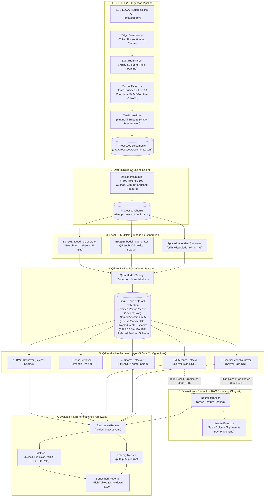
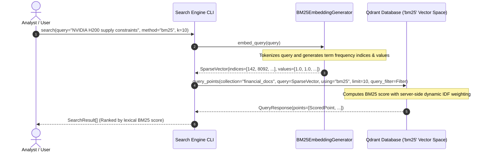
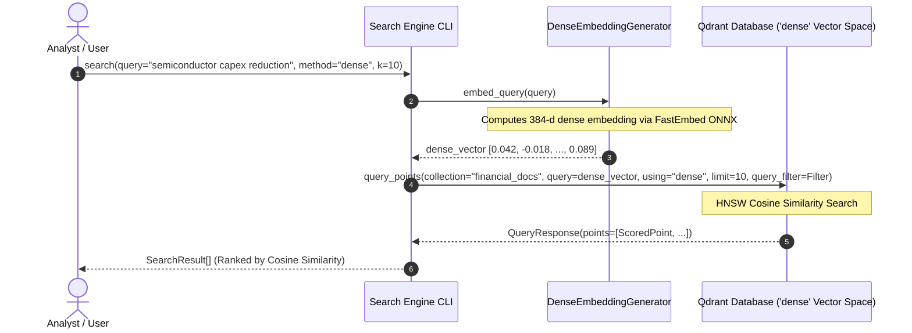
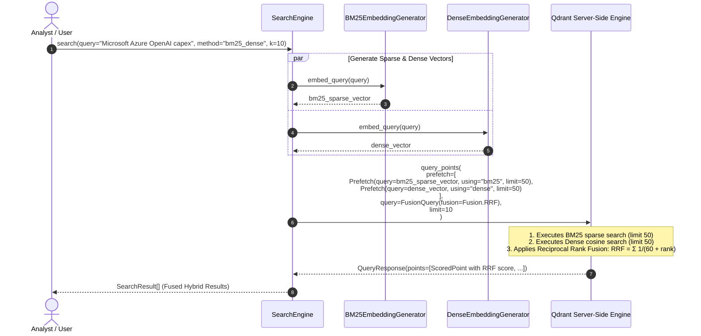
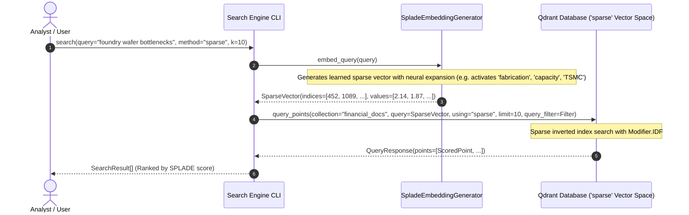
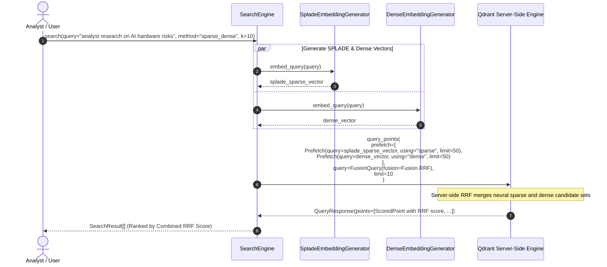
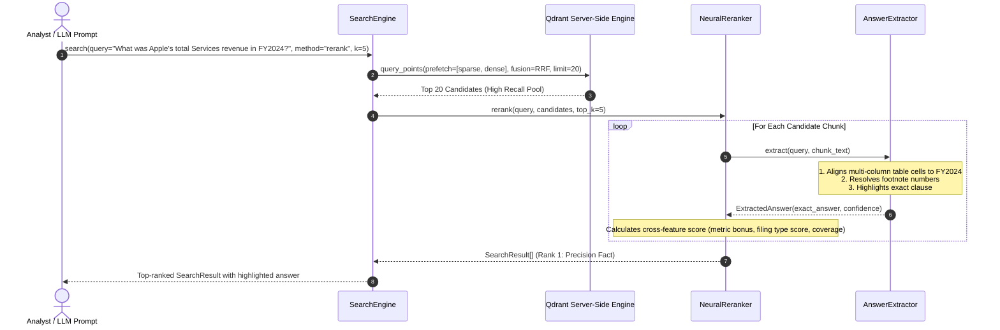

# System Architecture Documentation

This document provides a comprehensive technical overview of the Financial Intelligence Hybrid Search reference architecture on **Qdrant Vector Database**, including system component layouts, data flows for the 5 Qdrant-native retrieval methods and downstream Stage-2 reranking, module dependencies, Qdrant collection specifications, and evaluation methodology.

---

## 1. High-Level System Architecture



---

## 2. Data Flow Diagrams for Retrieval Configurations

### 2.1 Configuration 1: BM25 (Lexical Sparse Vector)

Pure exact-match lexical retrieval using the `Qdrant/bm25` model with server-side `Modifier.IDF`.



---

### 2.2 Configuration 2: Dense (Semantic Vector)

Semantic retrieval utilizing `BAAI/bge-small-en-v1.5` 384-dimensional dense vectors.



---

### 2.3 Configuration 3: BM25 + Dense Hybrid (Server-Side RRF)

Combines exact lexical sparse matching with dense semantic geometry in a single server-side call using Qdrant's `prefetch` and `FusionQuery(fusion=Fusion.RRF)`.



---

### 2.4 Configuration 4: Sparse Retrieval (SPLADE Learned Sparse)

Learned sparse neural retrieval utilizing `prithivida/Splade_PP_en_v1` with neural term expansion over a 30k BERT vocabulary.



---

### 2.5 Configuration 5: Sparse + Dense Hybrid (Server-Side RRF)

State-of-the-art hybrid search combining neural expansion sparse vectors with dense semantic embeddings, fused atomically inside Qdrant.



---

### 2.6 Downstream Stage-2 Extension: Neural Cross-Feature Reranking & Answer Extraction

Demonstrates how downstream RAG applications consume Qdrant's high-recall candidate pool for exact tabular and temporal precision.



---

## 3. Module Dependency Graph

```mermaid
graph TD
    subgraph Models["hybrid_search.models"]
        DocMod["document.py<br/>(Document, DocumentSection, Chunk)"]
        FiltMod["filter.py<br/>(MetadataFilter)"]
        SearchMod["search.py<br/>(SearchResult, SearchQuery)"]
    end

    subgraph Config["hybrid_search.config"]
        CfgMod["config.py<br/>(AppConfig, load_config)"]
    end

    subgraph Ingestion["hybrid_search.ingestion"]
        EdgarCl["edgar_client.py"]
        Downloader["downloader.py"]
        HtmlPars["html_parser.py"]
        SecExt["section_extractor.py"]
        Norm["normalizer.py"]
        Pipe["pipeline.py"]
    end

    subgraph Chunking["hybrid_search.chunking"]
        ChunkerMod["chunker.py"]
    end

    subgraph Embeddings["hybrid_search.embeddings"]
        DenseEmb["dense.py"]
        BM25Emb["bm25.py"]
        SpladeEmb["sparse.py"]
    end

    subgraph Indexing["hybrid_search.indexing"]
        QIndex["qdrant_index.py"]
    end

    subgraph Filtering["hybrid_search.filtering"]
        MetaFilt["metadata_filter.py"]
    end

    subgraph Retrieval["hybrid_search.retrieval"]
        BaseRet["base.py"]
        BM25Ret["bm25_retriever.py"]
        DenseRet["dense_retriever.py"]
        BM25DenseRet["bm25_dense_retriever.py"]
        SparseRet["sparse_retriever.py"]
        SparseDenseRet["sparse_dense_retriever.py"]
        RerankMod["reranker.py"]
        ExtractMod["extractor.py"]
        EngMod["engine.py"]
    end

    subgraph Evaluation["hybrid_search.evaluation"]
        MetricsMod["metrics.py"]
        LatMod["latency.py"]
        BenchMod["benchmark.py"]
        RepMod["report.py"]
    end

    subgraph CLI["hybrid_search.cli"]
        CLIMod["cli.py"]
    end

    %% Dependencies
    CfgMod --> Pipe & QIndex & EngMod & BenchMod & CLIMod
    DocMod --> Pipe & ChunkerMod & QIndex
    FiltMod --> MetaFilt & BaseRet & EngMod
    SearchMod --> BaseRet & EngMod

    EdgarCl & Downloader & HtmlPars & SecExt & Norm --> Pipe
    Pipe --> ChunkerMod
    ChunkerMod --> QIndex

    DenseEmb & BM25Emb & SpladeEmb --> QIndex & EngMod
    MetaFilt --> BM25Ret & DenseRet & BM25DenseRet & SparseRet & SparseDenseRet

    BaseRet --> BM25Ret & DenseRet & BM25DenseRet & SparseRet & SparseDenseRet
    ExtractMod --> RerankMod
    RerankMod --> EngMod
    BM25Ret & DenseRet & BM25DenseRet & SparseRet & SparseDenseRet --> EngMod

    EngMod --> BenchMod & CLIMod
    MetricsMod & LatMod & RepMod --> BenchMod
```



---

## 4. Qdrant Collection & Payload Design

### 4.1 Named Vectors Configuration
All embeddings for each chunk live within one single point in collection `financial_docs`:

```python
vectors_config = {
    "dense": models.VectorParams(
        size=384,
        distance=models.Distance.COSINE,
    )
}
sparse_vectors_config = {
    "bm25": models.SparseVectorParams(
        modifier=models.Modifier.IDF,
        index=models.SparseIndexParams(on_disk=False),
    ),
    "sparse": models.SparseVectorParams(
        modifier=models.Modifier.IDF,
        index=models.SparseIndexParams(on_disk=False),
    ),
}
```

### 4.2 Payload Indexing
Payload schema fields indexed for filtered candidate selection:
- `company` (`KEYWORD`): Full legal name of filer.
- `ticker` (`KEYWORD`): Ticker symbol (`NVDA`, `AAPL`, `MSFT`, etc.).
- `document_type` (`KEYWORD`): Form type (`10-K`, `10-Q`, `20-F`).
- `filing_date` (`DATETIME`): ISO 8601 filing date for range queries.
- `fiscal_period` (`KEYWORD`): Fiscal period label (`FY2024`, `Q3 FY2024`).
- `section` (`KEYWORD`): Item header code.
- `sector` (`KEYWORD`): Industry categorization.
- `geography` (`KEYWORD`): Geographic jurisdiction (`US`, `Taiwan`).

---

## 5. Evaluation Methodology & Metrics

### 5.1 Information Retrieval Metrics

1. **Recall@K:** Fraction of all relevant items retrieved in top-K:
   $$\text{Recall@K} = \frac{|\text{Relevant} \cap \text{Retrieved@K}|}{|\text{Relevant}|}$$

2. **Precision@K:** Fraction of retrieved items in top-K that are relevant:
   $$\text{Precision@K} = \frac{|\text{Relevant} \cap \text{Retrieved@K}|}{K}$$

3. **Mean Reciprocal Rank (MRR):** Quality of ranking the first relevant document:
   $$\text{MRR} = \frac{1}{|Q|} \sum_{q \in Q} \frac{1}{\text{rank}_{\text{first}}(q)}$$

4. **Normalized Discounted Cumulative Gain (NDCG@K):** Graded relevance ranking metric:
   $$\text{DCG@K} = \sum_{i=1}^K \frac{rel_i}{\log_2(i+1)}, \quad \text{NDCG@K} = \frac{\text{DCG@K}}{\text{IDCG@K}}$$

5. **Hit Rate@K:** Proportion of queries where at least one relevant document appears in top-K:
   $$\text{HitRate@K} = \mathbb{I}(|\text{Relevant} \cap \text{Retrieved@K}| > 0)$$

### 5.2 Latency Profiling
Recorded in microseconds with millisecond reporting across repeated executions:
- $p_{50}$ (Median execution time)
- $p_{95}$ (95th percentile tail latency)
- $p_{99}$ (99th percentile peak latency)
- Mean and standard deviation
